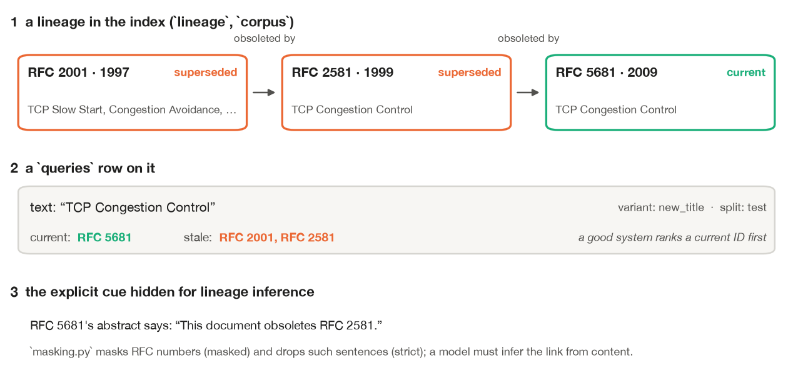
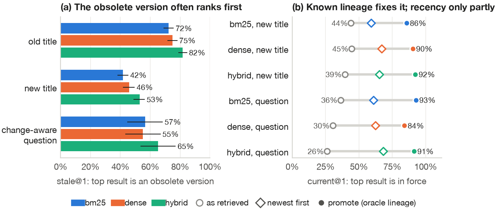
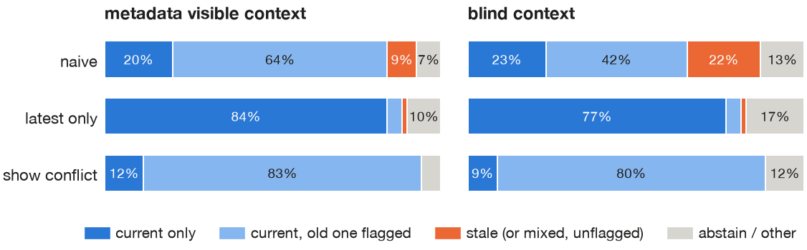
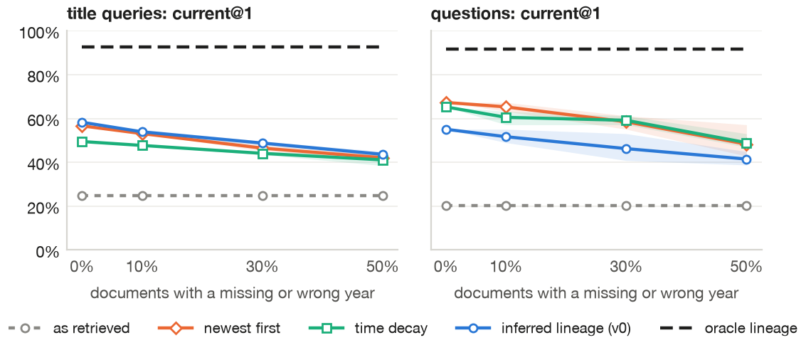
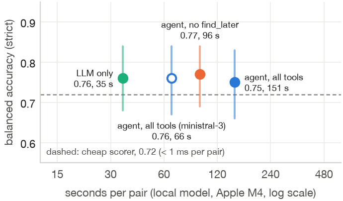

Search an index of IETF standards for **"TCP Congestion Control"** and a good hybrid retriever (BM25 plus embeddings) returns RFC 2581 first. That's a reasonable choice: it's titled *TCP Congestion Control* and states the topic plainly. It's also obsolete. RFC 5681 replaced it in 2009, and it comes second.

Nothing in a standard RAG pipeline tells the retriever which version is in force. And the obsolete document is often the *better* match: it has the canonical title and describes the topic directly, while its replacement spends half its abstract explaining what changed.

Anyone who has built RAG over a real document base (procedures, policies, specifications, internal standards) has seen this. I wanted to know how often it happens, whether it reaches the answer, and whether it can be fixed when the collection doesn't record which document replaces which. That last case is the normal one in most organisations.

---

## A benchmark where the answer is known

You can't measure staleness without ground truth about versions, and most collections don't have it. The RFC series does: the RFC Editor's index records exactly which RFC *obsoletes* which.

_One lineage from the dataset, a query on it, and the giveaway sentence that is hidden when the task is to infer the link._

From the index I built **Supersede-Bench**: 9,852 RFCs, 1,543 replacement links and 800 lineages (chains of versions). It comes with three kinds of test data:

- **Title queries:** the old or new title of each link, with the correct (current) and stale documents marked.
- **69 change-aware questions** whose answer actually changed between versions. Example: *which hash algorithm signs RSA-based DNS SIG records?* (MD5 before, SHA-1 after.) An LLM wrote them from both abstracts, and deterministic checks rejected anything unsupported or leaky.
- **120,390 candidate document pairs** for the harder task: recovering the links themselves.

Every lineage sits entirely in either the dev or the test split. The dataset is public on [Hugging Face](https://huggingface.co/datasets/hatoum/supersede-rfc).

---

## How bad is it?

**Retrieval.** On the change-aware questions, the hybrid retriever ranks an obsolete version first **65% of the time**. BM25 does it 57% of the time and dense retrieval 55%. Combining them makes it worse, consistent with the [HoH benchmark](https://arxiv.org/abs/2503.04800)'s finding that stronger retrievers fetch more outdated passages: the better a retriever gets at matching the topic, the better it gets at finding the canonical old version.

**Answers.** I gave the top 5 documents to a strong model (Claude Sonnet) and had a second model (Claude Haiku) judge whether each answer gave the current or the outdated value. When each passage shows its year and RFC number, the model sorts out versions by itself most of the time: 8.7% of answers are stale. Hide that metadata, as in a collection without reliable dates, and stale answers rise to **21.7%**.

The finding that surprised me most: **asked with no documents at all, the same model gives the current answer 80% of the time.** It has read these RFCs. So in this setup retrieval isn't supplying knowledge the model lacks. It's *overriding* knowledge it has. Of the 55 questions the model gets right closed-book, plain RAG without metadata turns 11 into stale answers.

On a private document base, which no model has read, there's no memory to fall back on.

---

## The fix is easy if you know the lineage

If the lineage is known, the fix is almost trivial. A re-ranker I call `promote` moves the current version of any superseded hit just above it. On the questions, the current document then comes first **91%** of the time, up from 26%.

At answer time, the best policy is to show both versions with the old one marked as replaced, rather than hiding it. With metadata hidden, that gives **0% stale answers** and 88% current ones, and the answer can say what changed ("Previously, …").

The catch is "if the lineage is known". In most document bases it isn't.

---

## Isn't "sort by date" enough?

The obvious fix is recency: prefer newer documents. A newest-first re-ranker gets the current version on top for 68% of questions, a big improvement on 26%. The trouble is that it bets everything on the dates.

So I corrupted them. I removed or shifted (by 1–10 years) the year of a growing share of documents, and watched each method degrade:

With half the years wrong, newest-first falls to 48% on questions. So does lineage inferred by my cheap scorer, which also leans on dates (55% to 41%). Only the true lineage, which doesn't depend on dates at all, stays at 92%. Recency is a fine baseline when the dates are clean. In a real document base, the date field is often a scan date, a migration date, or blank.

---

## Recovering the lineage without metadata

The harder task is to infer which document replaces which, with every explicit cue removed. The lineage fields are hidden, RFC numbers in the text are masked, and sentences like "This document obsoletes RFC 2581" are dropped.

**Cheap signals get you halfway.** A logistic regression on similarity and date features closes about **half the gap** between no lineage and perfect lineage on downstream retrieval (51% on title queries, 49% on questions). A dumb baseline does just as well: cluster near-duplicates and chain them by date. That "version chains" approach even has the better link F1 (0.62 vs 0.54).

The scorer is confident about most pairs. That suggests a **cascade**: let the cheap scorer settle the clear cases and send only the ambiguous ones (2,735 pairs in the test split) to something that reads.

---

## The librarian agent, and what it actually bought

The agent is a LangGraph state machine. A triage step uses the cheap score; an investigate step lets a local model call tools; a decide step returns a structured verdict (*supersedes*, *amends*, *conflicts*, *unrelated*) with a confidence and a rationale. The tools come from an MCP server: `search`, `read_doc`, `compare` and `find_later`, which looks for later documents on the same topic. Everything runs locally through Ollama on a 16 GB MacBook, with no API key.

To find out what the tools contribute, I ran three variants of the same model (Qwen 3.5, 9.7B parameters) on the same 100 ambiguous pairs (half true replacements):

| method | balanced accuracy | time per pair |
|---|---|---|
| cheap scorer | 0.72 | < 1 ms |
| one LLM call, no tools | **0.76** | 35 s |
| agent, without `find_later` | 0.77 | 96 s |
| agent, all tools | 0.75 | 151 s |
| agent, all tools (Ministral 3, 8B) | 0.76 | 66 s |

Reading the two documents helps a little, mostly by recognising later versions in the same series. **The tools don't help at all.** A single call without tools makes the same decision as the full agent on 93 of 100 pairs, at a quarter of the cost. The agent dutifully calls `compare` and `find_later` on every pair, but what it finds rarely changes its mind. None of the differences with the cheap scorer is statistically significant at this sample size. Repeated runs at temperature 0.3 move balanced accuracy by about ±0.02, so the conclusion doesn't hinge on one lucky run.

**When the dates are wrong.** I reran the same 100 pairs with half of all years removed or shifted. The cheap scorer dropped from 0.72 to 0.68: it reasons by date, so it starts missing true links. The single model call barely moved (0.76 → 0.74) and made the same decision on 90 of 100 pairs. That's the property a cascade needs: the step that reads doesn't lean on dates.

**What it does to retrieval.** In the cascade, the scorer keeps its verdicts on clear pairs and one model call decides the ambiguous ones. On the test questions, the current version now comes first 67% of the time, against 55% with the scorer alone and 92% with perfect lineage. That's two thirds of the gap closed instead of half: 7 questions fixed for 1 broken. With 49 questions, it isn't statistically significant yet (p = 0.07).

> **Updated 9 November 2026** with the corrupted-years and end-to-end results.
{: .prompt-info }

---

## Lessons

**The obsolete document is often the better match.** This isn't a retriever bug you can tune away. The old version has the canonical title and the plain description, so better topic matching finds it more reliably. Version awareness has to come from somewhere else.

**Measure the boring baseline first.** Newest-first ranking takes you most of the way when dates are clean, and nothing beats it cheaply when they are. Lineage only pays off when dates can't be trusted, so test that case explicitly, by corrupting the dates.

**Run the single LLM call before building the agent loop.** I built the tool-using agent first and the no-tools ablation second. The ablation matched the agent at a quarter of the cost. A ReAct loop is the impressive demo, but one well-prompted call on the right context was the result.

**Report what the model says *yes* to.** Every model variant said "replaces" on about 60% of a balanced sample. In the real band only 14% of pairs are true links, so precision in use would be lower than the cheap scorer's (0.29 vs 0.36). Balanced accuracy on a balanced sample hides that.

**Your laptop goes to sleep.** The first overnight run used 2.5 hours of compute out of 16: macOS put the machine to sleep on battery. Every queue now runs under `caffeinate`.

---

## Try it

- **Dataset:** [hatoum/supersede-rfc](https://huggingface.co/datasets/hatoum/supersede-rfc) on Hugging Face, with the masking script for the leakage-free view.
- **Code:** [github.com/CarlHatoum/supersede](https://github.com/CarlHatoum/supersede): the benchmark builder, the experiments, the agent, and a FastAPI service that does lineage-aware search, exposes the tools over MCP and the assessor over A2A.
